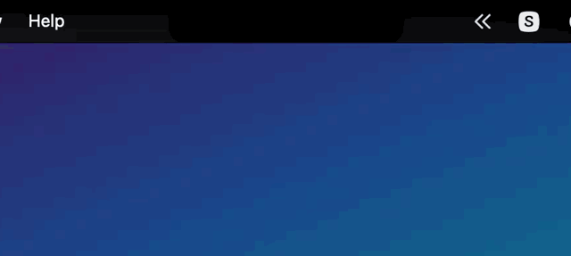
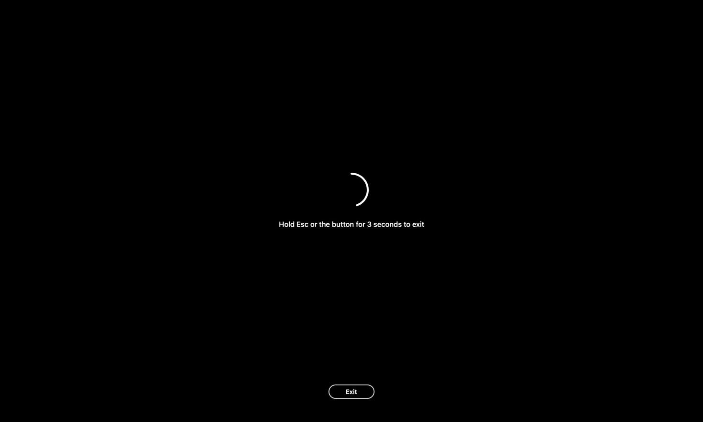
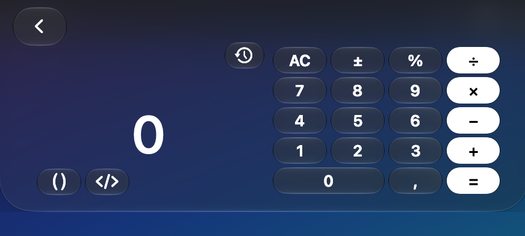
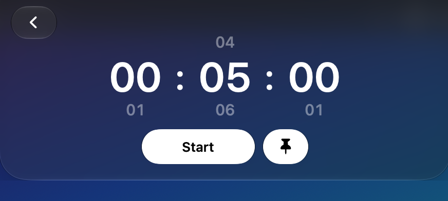
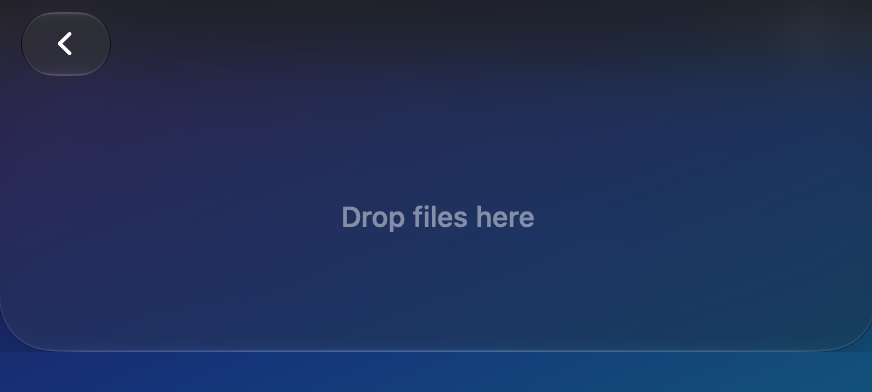
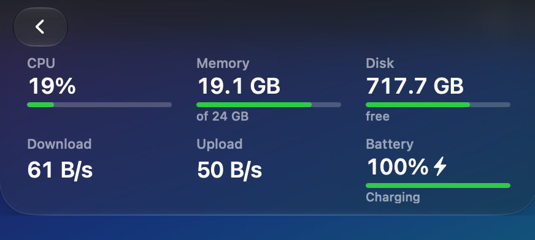
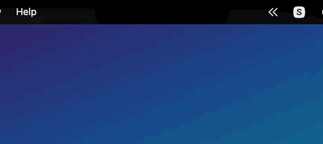

# Ledge

**A small, native "island" that lives around the MacBook notch.** Click the notch and a glass panel drops down with ten little tools: Keep Awake, a cleaning mode, calculator, timer, stopwatch, a file shelf, AirDrop, microphone mute, a mirror and a system monitor. No Dock icon, no accounts, no network.

[English](README.md) · [Русский](README.ru.md)



> **Notched MacBooks only.** On a Mac without a notch the island stays hidden. Ledge is developed and tested on **macOS 27**. It is built for macOS 13 and newer and falls back to a blur material before the glass look exists, but **versions older than 27 are untested**.

## Contents
- [Install](#install) · [Permissions](#permissions) · [Using it](#using-it) · [The tools](#the-tools) · [Make it yours](#make-it-yours)
- [Things that can bite you](#things-that-can-bite-you-read-this) · [How it works](#how-it-works) · [Build from source](#build-from-source) · [Languages](#languages) · [License](#license)

## Install

1. Download **`Ledge-0.1.0.dmg`** from the [Releases](../../releases) page.
2. Open it and drag **Ledge** into **Applications**.
3. **First launch (needed once per downloaded version).** Ledge is not notarized by Apple (that needs a paid developer account), so macOS blocks it the first time:
   - Double-click Ledge. macOS says it cannot verify the app. Click **Done**.
   - Open **System Settings → Privacy & Security**, scroll down to the message about Ledge and click **Open Anyway**. Enter your password.
   - Or do the same from Terminal: `xattr -dr com.apple.quarantine /Applications/Ledge.app`
4. Click the notch. That is it.

There is no Dock icon. A small **Ledge** icon in the menu bar opens **Settings** and **Quit**.

## Permissions

Ledge asks only for what a feature needs, only when you use that feature.

| Permission | Needed for | When it appears |
|---|---|---|
| **Accessibility** | Cleaning mode, to block the keyboard while you wipe it | When you press the Cleaning tile for the first time. Add Ledge under *System Settings → Privacy & Security → Accessibility*. |
| **Camera** | The mirror | The first time you open the mirror. |
| **Notifications** | "Timer finished" banner | If banners do not show: *System Settings → Notifications → Ledge*. |

Nothing else. No network access at all, see [How it works](#how-it-works).

## Using it

- **Open:** click the notch (hovering alone does not open it, it only gives a light trackpad tick). **Close:** move the pointer away. Clicks on the island itself never close it, so you cannot lose it by mistake.
- **Hover a tile:** it swells slightly, the trackpad ticks, and a line under the grid names the tile and shows its state (for example *Timer · 5:00*).
- **Click a tile:** switches a feature on or off, or opens its page. Use the **‹** button to come back.
- **Drag files to the notch:** the island opens by itself on a *drop screen* with two zones, **Shelf** and **AirDrop**. Drop on a zone. (Drop a little below the very top edge; see the Mission Control note below.)
- **Show the time next to the notch:** on the Timer and Stopwatch pages the pin button keeps the running time beside the notch while the island is closed.

## The tools

### Keep Awake
Click: keep the Mac awake until you click again. **Hold the tile** (about half a second): a page with two wheels (hours, minutes) opens. Scroll them like the timer's, press **Start** to stay awake for that long, or **Always** for no end. The tile then shows *until 16:38*. Uses a public power assertion; nothing is polled.


### Cleaning mode
Turns every screen black and swallows the **whole keyboard**, so you can wipe it. The **trackpad stays alive**. To leave, **hold Esc or the on-screen Exit button for 3 seconds** (a ring fills while you hold). The Mac and the display stay awake meanwhile. Needs the Accessibility permission. [What it cannot block](#things-that-can-bite-you-read-this).



### Calculator
A plain calculator, with two extras behind small buttons: **( )** for parentheses, powers, roots and fractions (`1/3 + 1/4 = 7/12`), and **</>** for a programmer mode (HEX / DEC / BIN / OCT, AND, OR, XOR, shifts, 64-bit). The clock button shows your history. Decimal arithmetic, so `0.1 + 0.2 = 0.3`. The keyboard works while the island is open.



### Timer and Stopwatch
The timer has scrollable wheels (hours, minutes, seconds), a choice of system sounds, a pulse of the digits in time with the end sound, and a system notification. Both can be pinned beside the notch.



### Shelf
A temporary stop for files. Drag files onto the notch; they appear on the shelf as icons. The shelf stores **references, not copies**, so nothing is duplicated and a moved file is still found. Click to open, drag out to drop anywhere, right-click for *Show in Finder* or *Remove from shelf*. The check-mark button lets you select several files and drag or remove them as a batch.



### AirDrop
Drop files on the **AirDrop** zone of the drop screen, or press the tile to choose files. The system's own AirDrop window opens beside the island and the island waits for you.

### Microphone
One click mutes the system's default microphone; the tile turns white while muted. The state follows changes made elsewhere (for example in a mixer).

### Mirror
A small floating window with your camera, flipped like a mirror. Drag it anywhere; ✕ or Esc closes it. The camera runs only while the window is open. Nothing is recorded or sent.

### Monitor
CPU, memory, free disk space, download and upload speed, battery (with a bolt while charging). Bars turn green, orange or red by level. **Values are read only while the island is open**, once a second; a closed island does no work.



## Make it yours

Press the **⇔** button in the top-left corner to rearrange.



- **Rearrange:** the tiles wiggle; drag them into the order you like.
- **Put one away:** drag it out of the frame. The frame and the tile turn red; let go and the tile disappears from the home screen (the feature keeps working). You can put away **up to five**.
- **Bring back:** a **+** button appears under ⇔ when something is put away. It opens a page with the put-away tiles: press one to bring it back, or **Bring back all**.
- **Switch a feature off completely:** *Settings → Modules*. A switched-off module creates nothing and observes nothing.
- **Settings** (menu bar icon): modules on/off, trackpad haptics, timer sound (with a test button), hiding the time beside the notch in full screen.

## Things that can bite you (read this)

- **Notched Macs only.** The island is placed over the hardware notch. On a Mac without one it hides. On an external display nothing is shown; it follows the display with the notch.
- **macOS 27 only is tested.** Older systems use a plain blur instead of the glass look and have not been checked.
- **Unsigned by Apple, so a warning on every new download.** You do the *Open Anyway* step once per downloaded version. Releases are signed with the author's own self-signed certificate (not an Apple one). The benefit: the signature stays the same from release to release, so **the Accessibility permission you grant survives updates**. The cost: macOS cannot vouch for the author.
- **Building it yourself changes the signature.** `tools/build.sh` signs with a local certificate called *Ledge Local Signing* if you have one, otherwise ad-hoc. An ad-hoc build looks like a new app to macOS after every rebuild, so **Accessibility must be granted again after each rebuild** (remove Ledge from the list with **−**, add it again).
- **Cleaning mode is protection against accidental key presses, not a lock.** It cannot block the physical power button, Mission Control gestures or hot corners, and a system shortcut like Spotlight can take the focus away; when the app loses focus the mode ends by itself. A long press of the power button always works in hardware.
- **Keep Awake keeps the Mac from sleeping when idle.** It does not stop closing the lid from putting the Mac to sleep.
- **Dragging a file to the very top edge opens Mission Control** (macOS does that, and it cannot be switched off by an app). Ledge opens the island as soon as the file is near the notch; drop it on the island below the edge.
- **AirDrop** needs Wi-Fi and Bluetooth on; the system window tells you if not.
- **Microphone mute** works with devices that have a mute switch or a settable volume. Others show *Unavailable*. There is no camera switch: macOS does not allow it without heavy machinery.
- **Timer notifications** may be switched off for Ledge in System Settings; the timer still plays its sound.
- **No automatic updates, on purpose.** Ledge never touches the network. To update, download the new release and replace the app. On GitHub, *Watch → Custom → Releases* emails you about new ones.
- **Translations were made by an AI**, not by native speakers (see [Languages](#languages)).
- **Not included, on purpose:** clipboard history, colour picker, quick notes, now-playing, volume/brightness popups, pets. Good separate apps already do these.

## How it works

The short version (the long one is in [docs/HOW-IT-WORKS.md](docs/HOW-IT-WORKS.md)):

- **Two windows.** A closed island is a small black `NSPanel` exactly over the notch. Opening it shows a second, glass panel (the system's Liquid Glass material, with a blur fallback) that grows from the notch. Both are borderless AppKit panels; SwiftUI is used only for the Settings form.
- **Modules.** Every feature is a module (`UIModule`) that offers a tile and, optionally, a page. A registry starts and stops modules in isolation: if one fails, only that module switches off; a module that crashes during start is switched off on the next launch (protection against a crash loop). A switched-off module holds no objects and no observers.
- **Event-driven.** No polling timers. The island reacts to pointer, display, power and audio events. Values that need refreshing (monitor, running clocks) tick once a second **only while someone can see them**; a closed island with nothing pinned does no work at all.
- **Public APIs only.** AppKit, Core Audio, IOKit power sources, AVFoundation, NSSharingService, CGEvent taps. No private frameworks, no `dlopen`.
- **Zero network.** There is no networking code and no dependencies. A lint script (`tools/lint-rules.sh`) fails the build on network APIs, private frameworks, polling timers and external packages.
- **Logic is separate and tested.** Everything that can be decided without a screen lives in `LedgeCore` (state machine, calculators, timers, shelf, tile arrangement, monitor maths…) and is covered by 200+ unit tests (Swift Testing). The AppKit shell is checked by hand and with small scripts that drive the real app (`tools/ui-test`).

## Build from source

You need Xcode with the **macOS 27 SDK** (the glass material API is used behind availability checks), and a notched Mac to see anything.

```sh
git clone https://github.com/denispe42/Ledge.git && cd Ledge
tools/run-tests.sh          # lint + build + unit tests
tools/build.sh              # universal (arm64 + x86_64) dist/Ledge.app
VERSION=0.1.0 tools/build.sh --dmg   # also dist/Ledge-0.1.0.dmg
open dist/Ledge.app
```

Swift Package Manager only, no Xcode project, no external dependencies. See the notes above about signing and the Accessibility permission when you build yourself.

## Languages

English, Russian, German, French, Spanish, Italian, Portuguese (Brazil), Polish, Czech, Ukrainian, Turkish, Japanese, Korean, Simplified Chinese. The language follows the system. **The translations were produced by an AI and have not been checked by native speakers**; corrections are very welcome as pull requests to `Resources/<language>.lproj/Localizable.strings` (a unit test keeps every language in step with English, including `%d` / `%@` placeholders).

## License

MIT, see [LICENSE](LICENSE). Ledge is a hobby project, provided as is; **no support is promised**, though issues and pull requests are read.
