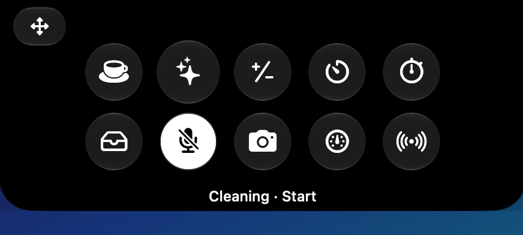

# Ledge

**Небольшой нативный «остров» вокруг выреза (notch) MacBook.** Клик по вырезу, и вниз раскрывается стеклянная панель с десятью маленькими инструментами: «Не засыпать», режим очистки, калькулятор, таймер, секундомер, полка для файлов, AirDrop, выключатель микрофона, зеркало и системный монитор. Без значка в Dock, без аккаунтов, без сети.

[English](README.md) · [Русский](README.ru.md)

## Зачем появился Ledge

«Острова» для выреза уже существуют, и их много. Большинство пытается превратить вырез во второй Dynamic Island: виджеты «сейчас играет» с обложками и визуализацией, собственные баннеры уведомлений, замена HUD, менеджеры буфера обмена, календари. Ledge сознательно идёт в другую сторону.

**Он для тех, у кого под каждую задачу уже есть любимое отдельное приложение** (менеджер буфера обмена, микшер звука, лаунчер) и кто не хочет, чтобы одна программа заменяла их все. Ledge их не заменяет. Он добавляет небольшой набор утилит, ради которых отдельное приложение было бы избыточным, а всё остальное время не мешает.

В основе несколько осознанных решений:

- **Нет медиаплеера.** Обложки и анимированная визуализация треков в вырезе постоянно отвлекают. Воспроизведением и так управляют встроенный плеер системы и медиаклавиши, поэтому Ledge музыку не трогает.
- **Нет собственной системы уведомлений.** Ledge не рисует баннеры и HUD, поэтому не конфликтует с системными уведомлениями. Единственное, что он отправляет, это стандартное системное уведомление о завершении таймера.
- **Тихий по умолчанию.** Остров закрыт, пока вы не нажмёте на вырез или не проведёте по нему вниз. Наведение даёт лишь лёгкий отклик трекпада. Ничто не анимируется ради анимации.
- **Построен вокруг железа.** Он сделан именно под вырез и продолжает визуальный язык macOS 27 и Liquid Glass: стеклянная панель, вырастающая из выреза, значки и текст строго чёрно-белые, без цветных акцентов.
- **Маленький, нативный, офлайн.** Только публичные API Apple, без сторонних зависимостей, без сети, на событиях, а не на опросе по таймеру. Каждый инструмент это независимый модуль со своим выключателем; выключенный модуль не держит ни объектов, ни наблюдателей. Сбой одного отключает только его.

Коротко: минималистичный и предсказуемый остров под рабочий процесс одного человека, опубликованный на случай, если он подойдёт и вам.


> **Только MacBook с вырезом.** На Маке без выреза остров скрыт. Ledge разрабатывается и проверяется на **macOS 27**. Он собран под macOS 13 и новее и, пока нет стекла, использует размытие, но **версии старше 27 не проверялись**.

## Установка

1. Скачайте **`Ledge-0.4.0.dmg`** на странице [Releases](../../releases).
2. Откройте образ и перетащите **Ledge** в **Программы**.
3. **Первый запуск (нужен один раз для каждой скачанной версии).** Приложение не прошло нотаризацию Apple (она требует платной подписки разработчика), поэтому macOS блокирует его при первом открытии:
   - Дважды нажмите на Ledge. macOS напишет, что не может проверить приложение. Нажмите **Готово**.
   - Откройте **Системные настройки → Конфиденциальность и безопасность**, прокрутите вниз до сообщения про Ledge и нажмите **«Всё равно открыть»**, введите пароль.
   - То же из Терминала: `xattr -dr com.apple.quarantine /Applications/Ledge.app`
4. Нажмите на вырез. Всё.

Значка в Dock нет. Маленький смайлик в меню-баре (или правый клик по вырезу) открывает **Настройки** и **Выйти**.

## Разрешения

Ledge просит только то, что нужно функции, и только когда вы ею пользуетесь.

| Разрешение | Для чего | Когда появляется |
|---|---|---|
| **Универсальный доступ** | Режим очистки: блокирует клавиатуру, пока вы её протираете | При первом нажатии плитки «Очистка». Добавьте Ledge в *Системные настройки → Конфиденциальность и безопасность → Универсальный доступ*. |
| **Камера** | Зеркало | При первом открытии зеркала. |
| **Уведомления** | Баннер «Таймер завершён» | Если баннера нет: *Системные настройки → Уведомления → Ledge*. |

Больше ничего. Доступа к сети нет вовсе.

## Как пользоваться

- **Открыть:** клик по вырезу (наведение само не открывает, а только даёт лёгкий отклик трекпада) или свайп двумя пальцами **вниз** по нему. **Закрыть:** убрать курсор или свайп двумя пальцами **вверх**. Клики по самому острову его не закрывают.
- **Навести на плитку:** она слегка вырастает, трекпад откликается, под сеткой появляется название и состояние («Таймер · 5:00»).
- **Нажать на плитку:** включает или выключает функцию, либо открывает её страницу. Кнопка **‹** возвращает назад.
- **Перетащить файлы на вырез:** остров сам откроется на *экране дропа* с двумя зонами, **«Полка»** и **AirDrop**. Бросьте файл в нужную зону (чуть ниже самого верхнего края, см. про Mission Control).
- **Время рядом с вырезом:** на страницах таймера и секундомера кнопка-булавка оставляет бегущее время рядом с вырезом, пока остров закрыт.

## Инструменты

- **Не засыпать.** Клик: не засыпать, пока не нажмёте снова. **Удерживайте плитку** (около полсекунды): откроются два колеса (часы и минуты), кнопка **«Старт»** включает на это время, **«Всегда»** без конца. Плитка покажет «до 16:38».
  
- **Режим очистки.** Все экраны чёрные, **вся клавиатура заблокирована**, можно протирать. **Трекпад остаётся живым.** Выход: **удерживать Esc или кнопку «Выйти» 3 секунды** (вокруг заполняется кольцо). Мак и экран при этом не засыпают. Нужен «Универсальный доступ».
  
- **Калькулятор.** Обычный, плюс **( )** (скобки, степени, корни, дроби: `1/3 + 1/4 = 7/12`) и **</>** (программистский: HEX/DEC/BIN/OCT, AND/OR/XOR, сдвиги, 64 бита). Кнопка с часами: история. Счёт десятичный: `0,1 + 0,2 = 0,3`.
- **Таймер и секундомер.** У таймера колёса часов, минут и секунд, выбор системного звука, пульсация цифр в такт звуку, уведомление.
- **Полка.** Временная стоянка файлов. Хранит **ссылки, а не копии**; файл можно открыть, вытащить наружу, показать в Finder; кнопка с галочкой выбирает несколько файлов.
- **AirDrop.** Бросьте файлы в зону AirDrop или нажмите плитку и выберите файлы: откроется системное окно AirDrop рядом с островом.
- **Микрофон.** Один клик выключает звук системного микрофона; пока он выключен, плитка белая.
- **Зеркало.** Маленькое плавающее окно с камерой, отражённой как в зеркале. ✕ или Esc закрывает. Камера работает, только пока окно открыто; ничего не записывается.
- **Монитор.** Процессор, память, свободное место, приём и отдача сети, батарея (с молнией при зарядке). Цифры читаются **только пока остров открыт**.

## Свой порядок и свой набор

Кнопка **⇔** в левом верхнем углу включает режим расстановки.


- **Расставить:** плитки подрагивают; перетащите в нужном порядке.
- **Убрать:** вытащите плитку за рамку, рамка и плитка покраснеют, отпустите. Функция продолжит работать, просто плитки не будет на экране. **Не больше пяти** убранных.
- **Вернуть:** под ⇔ появляется кнопка **+**: страница со спрятанными плитками (нажмите на нужную) и кнопка **«Вернуть все»**.
- **Выключить функцию совсем:** *Настройки → Модули*. Выключенный модуль ничего не создаёт и ни за чем не следит.
- **Вид:** *Настройки → Основное → Вид острова*: **Стекло** (системное Liquid Glass, по умолчанию) или **Чёрный** (сплошной чёрный, сливается с вырезом). Применяется сразу.



- **Автозапуск при входе** включён **по умолчанию** (выключается в *Настройки → Основное* или в *Системные настройки → Основные → Объекты входа*). Окно настроек закрывается само, когда вы нажимаете в другом месте.
- **Язык:** *Настройки → Основное → Язык*: **Как в системе** (по умолчанию, следует языку системы, даже если его сменить) или любой из 14 языков. Для применения приложение перезапускается.

## Подводные камни (прочитайте)

- **Только Маки с вырезом.** На внешнем мониторе ничего не показывается: остров следует за дисплеем с вырезом.
- **Проверялось только на macOS 27.**
- **Подписи Apple нет, поэтому предупреждение при каждой новой скачанной версии.** Релизы подписаны собственным самоподписанным сертификатом автора. Плюс: подпись одинакова от релиза к релизу, поэтому **выданное «Универсальному доступу» разрешение переживает обновления**. Минус: macOS не ручается за автора.
- **Если собираете сами, подпись другая.** `tools/build.sh` подписывает локальным сертификатом *Ledge Local Signing*, если он есть, иначе временной подписью; после каждой пересборки macOS считает приложение новым, **разрешение «Универсальный доступ» придётся выдавать заново** (удалить Ledge из списка кнопкой **−** и добавить снова).
- **Режим очистки защищает от случайных нажатий, но не замок.** Он не блокирует физическую кнопку питания, жесты Mission Control и горячие углы; если приложение потеряло фокус (например, открылся Spotlight), режим сам заканчивается.
- **«Не засыпать»** не даёт Маку заснуть от простоя, но закрытие крышки всё равно усыпляет его.
- **Файл у самого верхнего края экрана открывает Mission Control** (так делает macOS, приложение этого отключить не может). Остров открывается раньше, как только файл рядом с вырезом: бросайте на остров, не доводя до края.
- **AirDrop** требует включённых Wi-Fi и Bluetooth.
- **Микрофон:** работает с устройствами, у которых есть выключатель звука или регулируемая громкость; у остальных «Недоступно». Выключателя камеры нет: macOS этого не разрешает.
- **Без автообновления, намеренно.** Ledge никогда не обращается к сети. Чтобы обновиться, скачайте новый релиз и замените приложение. *Watch → Custom → Releases* на GitHub присылает письма о новых версиях.
- **Переводы сделаны ИИ**, а не носителями языка.
- **Намеренно нет:** истории буфера обмена, пипетки цвета, быстрых заметок, «сейчас играет», всплывающих окон громкости и яркости, питомцев.

## Как устроено

Подробнее в [docs/HOW-IT-WORKS.md](docs/HOW-IT-WORKS.md). Коротко: два окна (чёрная таблетка над вырезом и стеклянная панель), каждая функция это модуль с изоляцией сбоев, без опроса по таймеру (читается только то, что сейчас видно), только публичные API Apple, никакой сети и зависимостей (это проверяет `tools/lint-rules.sh`), вся логика отдельно от интерфейса и покрыта 200+ тестами.

## Сборка из исходников

Нужен Xcode с **SDK macOS 27** и Мак с вырезом.

```sh
git clone https://github.com/denispe42/Ledge.git && cd Ledge
tools/run-tests.sh                    # проверки, сборка, тесты
tools/build.sh                        # универсальный dist/Ledge.app
VERSION=0.4.0 tools/build.sh --dmg    # плюс dist/Ledge-0.4.0.dmg
```

## Языки

Английский, русский, немецкий, французский, испанский, итальянский, португальский (Бразилия), польский, чешский, украинский, турецкий, японский, корейский, китайский упрощённый. **Переводы сделаны ИИ и не проверены носителями**; исправления приветствуются (pull request в `Resources/<язык>.lproj/Localizable.strings`).

## Лицензия

MIT, см. [LICENSE](LICENSE). Любительский проект «как есть»; **поддержка не обещана**.
